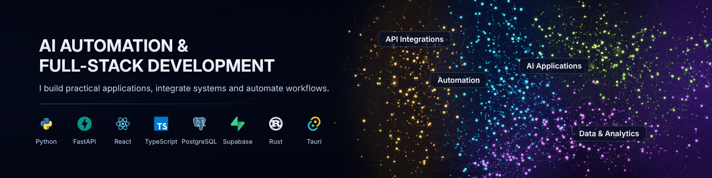
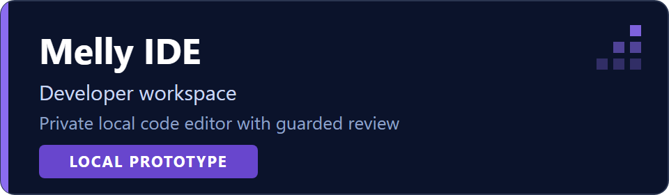
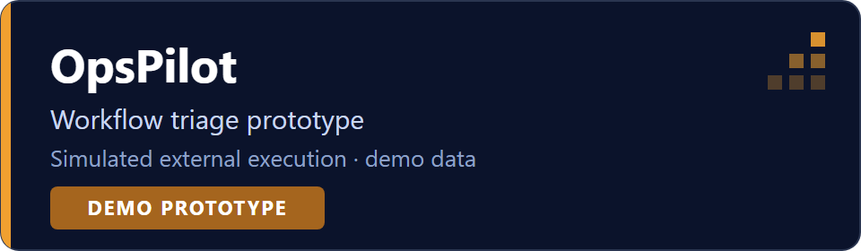
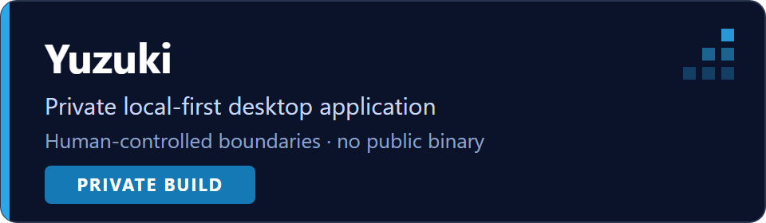
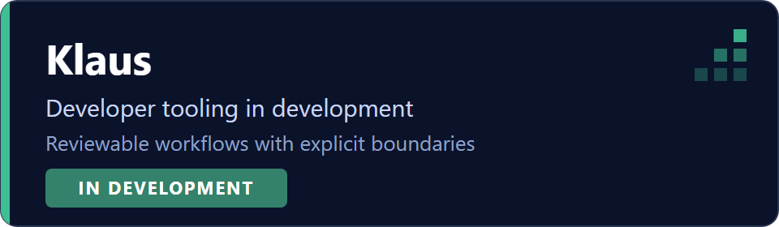
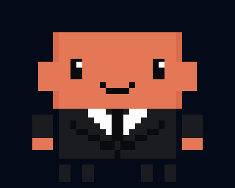

  

  <picture>
    <source media="(prefers-reduced-motion: reduce)" srcset="assets/brand/typing-fallback.png" />
  
  </picture>

# Hi, I'm Mateusz Ozimkiewicz

**AI Automation & Full-Stack Developer**

I build practical desktop tools, workflow automation and full-stack applications with explicit human review and clear product boundaries.

Based in Toruń, Poland · working remotely · open to B2B, contract and full-time remote roles.

## Tech stack

Backend: Python · FastAPI · PostgreSQL · Supabase 
Frontend: React · TypeScript · JavaScript 
Desktop: Rust · Tauri

## Featured work

### Melly IDE

  

A private local code editor prototype with projects, files, backups, offline working copies and guarded change review. The UX02 v4 baseline covers Dashboard ("Hello World"), Code & Review, Agents & Tools, and Agent Chat with local drafts; Pro is an informational preview.

AI replies are disconnected in this baseline. Production authentication, billing and an iOS release are not available. Physical iPhone Safari/PWA acceptance is pending; licensing review remains open. Local development evidence is separate from the private repository's published commit.

### OpsPilot

  

A deterministic triage demo with human review and simulated external actions. It demonstrates an operations workflow on demo data; live outbound automation is not enabled.

### Yuzuki

  

A private, local-first desktop AI application under development, with human-controlled boundaries. No public binary is offered.

### Klaus

  

Developer tooling in development, focused on reviewable workflows and explicit execution boundaries.

## Engineering principles

- Make implemented, simulated and planned capabilities clear.
- Keep external actions human-controlled and observable.
- Prefer explicit contracts and provider adapters.
- Treat testing, deployment and live verification as separate gates.

  <picture>
    <source media="(prefers-reduced-motion: reduce)" srcset="assets/mellypet/idle-static.png" />
    
  </picture>

## Let's work together

For workflow automation, desktop tools or full-stack development, explore the [portfolio](https://mateusz-ozimkiewicz-portfolio.vercel.app) or email [mateusz.ozimkiewicz9@gmail.com](mailto:mateusz.ozimkiewicz9@gmail.com).

Featured products are my own projects, not client deliveries. Project cards and badges are static maturity labels, not live build results or claims of commercial deployment.
